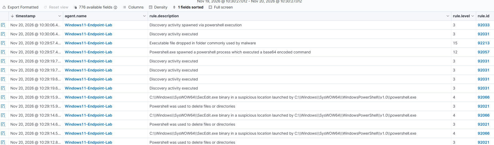
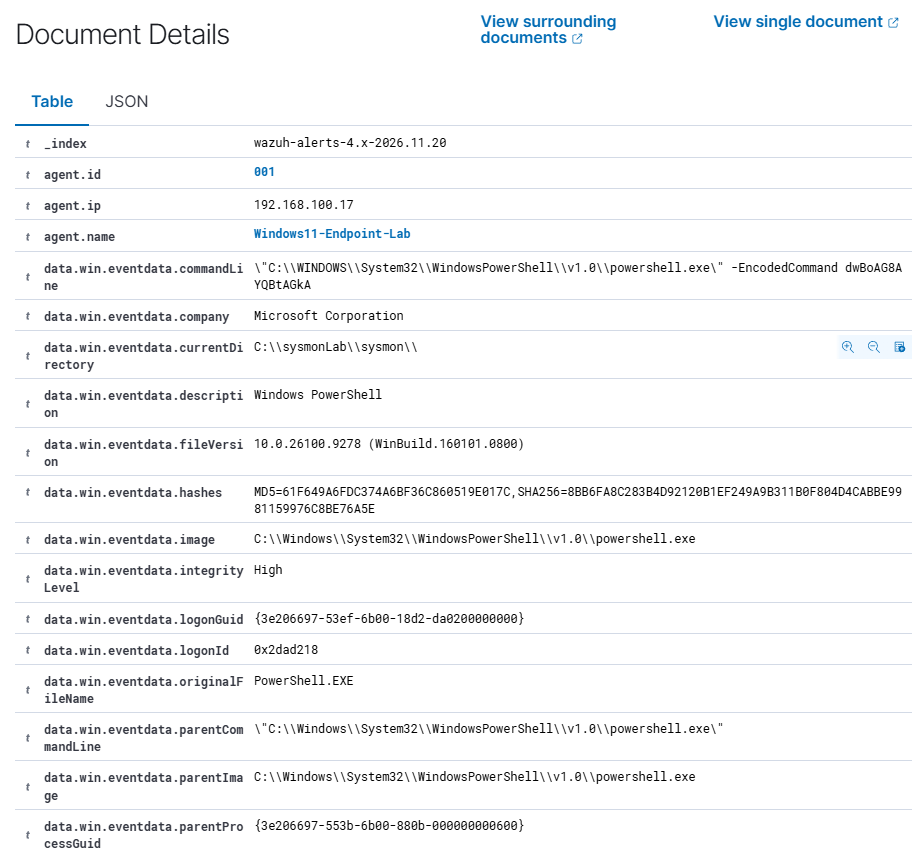

# 🛡️ Windows 11 Endpoint Threat Detection with Sysmon & Wazuh SIEM

## 📌 Project Overview
Standard Windows Event Logs often lack deep visibility into process creation hierarchies, command-line arguments, and file hashes. This project demonstrates how to enhance endpoint telemetry on **Windows 11 Pro** by deploying **Microsoft Sysmon** with custom event filtering rules, forwarding the `Microsoft-Windows-Sysmon/Operational` channel to **Wazuh SIEM** for real-time threat detection and **MITRE ATT&CK** mapping.

---

## 🏗️ Lab Architecture
* **Monitored Endpoint:** Windows 11 Pro workstation (`Windows11-Endpoint-Lab`) running Wazuh Agent + Sysmon (`configs/sysmonconfig.xml` tracking Process Creation ID 1, Network Connections ID 3, File Creation ID 11, and Registry Persistence ID 13).
* **SIEM Server:** Linux Mint workstation hosting Wazuh Manager, Indexer, and Dashboard via Docker.

---

## ⚙️ Technical Implementation

### 1. Sysmon Deployment & Custom Filtering (`configs/sysmonconfig.xml`)
Sysmon was configured to capture SHA-256/MD5 hashes and filter high-value telemetry while reducing noise:
* **Event ID 1 (`ProcessCreate`):** Captures full parent-child process trees and obfuscated command lines.
* **Event ID 3 (`NetworkConnect`):** Monitors outbound connections initiated by living-off-the-land binaries (`powershell.exe`, `cmd.exe`, `rundll32.exe`).
* **Event ID 11 (`FileCreate`):** Tracks executable drops in high-risk directories (`\Temp\`, `\Downloads\`, `\Desktop\`).
* **Event ID 13 (`RegistryEvent`):** Alerts on persistence modifications under `\CurrentVersion\Run`.

### 2. Wazuh Agent EventChannel Integration
Configured the Wazuh Agent (`ossec.conf`) on the Windows 11 endpoint to ingest Sysmon logs in real time:
```xml
<localfile>
  <location>Microsoft-Windows-Sysmon/Operational</location>
  <log_format>eventchannel</log_format>
</localfile>
```

---

## 🔍 Adversary Simulation & Detection Results

### 1. Real-Time Alert Correlation (Base64 PowerShell & Suspicious File Drop)
To validate detection capabilities, an adversary simulation was conducted using Base64-encoded PowerShell execution (`powershell.exe -EncodedCommand ...`) and system discovery commands (`net user`). Wazuh triggered multiple high-severity alerts:



* **Rule `92057` (Level 12):** Detected `powershell.exe` spawning a child PowerShell process executing a Base64-encoded command (**MITRE ATT&CK `T1059.001`**).
* **Rule `92213` (Level 15):** Flagged an executable dropped in a monitored staging directory (**Sysmon Event ID 11**).
* **Rules `92031` / `92033`:** Correlated local account and system discovery activities (**MITRE ATT&CK `T1087`**).

### 2. Forensic Telemetry Inspection (`Rule 92057`)
Expanding the Level 12 alert reveals granular forensic artifacts provided by Sysmon, including the exact `CommandLine`, `ParentImage`, `IntegrityLevel` (`High`), and executable `Hashes` (MD5/SHA-256) required for Tier 1 SOC triage:



---

## 🛠️ SOC Triage & Remediation Recommendations
1. **Command Decoding & Validation:** Decode the Base64 payload (`dwBoAG8AYQBtAGkA` -> `whoami`) to determine intent and assess whether unauthorized reconnaissance occurred.
2. **Execution Policy Enforcement:** Enforce PowerShell Constrained Language Mode and Script Block Logging via Group Policy (GPO).
3. **Host Isolation:** If malicious persistence or unauthorized C2 traffic is confirmed via Sysmon Event ID 3, isolate the endpoint using EDR/Wazuh Active Response.
